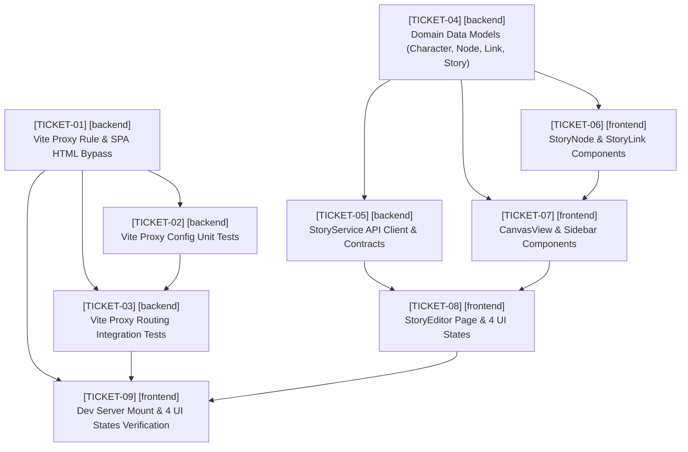

# Story Builder Task Tickets

Based on the architectural specifications in `SPEC.md`, this ticket plan breaks down development into atomic, sequentially executable engineering tasks. Each ticket is tagged with either `[backend]` or `[frontend]` and includes exact target files, prerequisites, and test-driven verification criteria.

---

## Ticket Overview & Dependency Graph

---

## Tickets

- [x] **[TICKET-01] [backend] Update Vite Proxy Rule for '/s' with Precise Regex and SPA HTML Bypass**
  - **Target Files**: `client/vite.config.ts`
  - **Prerequisites**: None
  - **Description**:
    Update the Vite proxy configuration in `client/vite.config.ts`. Replace the naive `'/s'` prefix proxy mapping with a regex pattern `'^/s/.*'` to prevent intercepting Vite internal source paths such as `/src/main.tsx`, `/styles/*`, `/node_modules/*`, and `/@vite/*`.
    Add a proxy `bypass` function to `'^/s/.*'` that inspects `req.headers.accept`:
    - When `req.headers.accept?.includes('text/html')`, return `'/index.html'` so direct browser navigation to `/s/:shareToken` routes serves the Single Page Application HTML rather than forwarding to the backend API.
    - When the request is an API request (e.g., `application/json`), return `undefined` to allow proxying to `apiTarget` (`http://localhost:5000` or `process.env.VITE_API_TARGET`).
    - Preserve backward compatibility for `/api` and `/uploads` proxy rules.
  - **TDD Criteria**:
    - Vite config exports proxy definition where `proxy['^/s/.*']` is configured and naive `proxy['/s']` is removed.
    - `proxy['^/s/.*'].bypass` is defined as a function.
    - `proxy['^/s/.*'].bypass({ headers: { accept: 'text/html,application/xhtml+xml' } })` returns `'/index.html'`.
    - `proxy['^/s/.*'].bypass({ headers: { accept: 'application/json' } })` returns `undefined` (proxying proceeds).
    - `proxy['^/s/.*'].target` resolves to `http://localhost:5000` by default, or respects `process.env.VITE_API_TARGET` and `PORT`.

- [x] **[TICKET-02] [backend] Update and Extend Vite Proxy Configuration Unit Tests**
  - **Target Files**: `client/src/tests/viteProxyConfig.test.ts`
  - **Prerequisites**: `[TICKET-01]`
  - **Description**:
    Update existing unit tests in `client/src/tests/viteProxyConfig.test.ts` to assert against the new regex-based proxy rule and bypass logic.
    Remove assertions expecting `proxy['/s']` and replace them with assertions for `proxy['^/s/.*']`.
    Add test cases asserting:
    - `proxy['^/s/.*']` target resolution default (`http://localhost:5000`) and override behavior (`PORT`, `VITE_API_TARGET`).
    - `proxy['^/s/.*'].changeOrigin` is `true` and `secure` is `false`.
    - `bypass` handler returns `'/index.html'` for browser HTML navigation requests (`accept: text/html...`).
    - `bypass` handler returns `undefined` for API requests (`accept: application/json` or missing).
  - **TDD Criteria**:
    - Test `resolves default target to http://localhost:5000`: checks `proxy['^/s/.*'].target === 'http://localhost:5000'` and `proxy['/s'] === undefined`.
    - Test `respects PORT override`: checks `proxy['^/s/.*'].target === 'http://localhost:5002'` when `PORT=5002`.
    - Test `respects VITE_API_TARGET override over PORT`: checks `proxy['^/s/.*'].target === 'http://localhost:5001'` when `VITE_API_TARGET` is set.
    - Test `bypasses proxy to /index.html when request accepts text/html`: calls `proxy['^/s/.*'].bypass` with HTML accept header and expects `'/index.html'`.
    - Test `does not bypass proxy for API requests`: calls `proxy['^/s/.*'].bypass` with JSON accept header and expects `undefined`.

- [x] **[TICKET-03] [backend] Extend Vite Proxy Routing Integration Tests for Asset Protection and Backend Routing**
  - **Target Files**: `client/src/tests/viteProxyRouting.test.ts`
  - **Prerequisites**: `[TICKET-01]`, `[TICKET-02]`
  - **Description**:
    Extend integration tests in `client/src/tests/viteProxyRouting.test.ts` which spin up a real Vite dev server and a mock backend server:
    - Verify that `GET /src/main.tsx` returns `HTTP 200` served by Vite (Content-Type contains `javascript`), proving that source assets starting with `/s` are no longer intercepted by the proxy.
    - Verify that `GET /s/share-xyz` with `Accept: application/json` is proxied to the mock backend and returns `HTTP 200` with `{ shareId: 'share-xyz' }`.
    - Verify that `GET /s/share-xyz` with `Accept: text/html` returns `HTTP 200` containing Vite `index.html` (SPA HTML bypass).
    - Verify that direct navigation `GET /dashboard` returns `HTTP 200` containing `index.html` (SPA fallback).
    - Ensure regression tests continue to pass for `GET /api/health`, `GET /uploads/sample.png`, and `GET /api/ai/stream` (SSE).
  - **TDD Criteria**:
    - Integration test `GET http://127.0.0.1:${vitePort}/src/main.tsx` returns status `200` and response body containing source module code.
    - Integration test `GET http://127.0.0.1:${vitePort}/s/share-xyz` with header `Accept: application/json` returns status `200` and JSON `{ shareId: 'share-xyz' }`.
    - Integration test `GET http://127.0.0.1:${vitePort}/s/share-xyz` with header `Accept: text/html` returns status `200` and HTML text containing `
` or `<script type="module" src="/src/main.tsx">`.
    - Integration test `GET http://127.0.0.1:${vitePort}/dashboard` returns status `200` with HTML content.
    - Integration test `GET http://127.0.0.1:${vitePort}/api/health` returns status `200` with `{ ok: true }`.
    - Integration test `GET http://127.0.0.1:${vitePort}/api/ai/stream` streams chunks through proxy without truncation.

- [x] **[TICKET-04] [backend] Define Domain Data Models (Character, Node, Link, Story)**
  - **Target Files**: `client/src/types/story.ts`, `client/src/tests/storyModels.test.ts`
  - **Prerequisites**: None
  - **Description**:
    Implement the TypeScript domain data models specified in SPEC §2:
    - `Character`: `id: string`, `name: string`, `description: string`, `avatarUrl?: string`, `createdAt: string`.
    - `Node`: `id: string`, `storyId: string`, `title: string`, `content: string`, `characters: string[]`, `isStartNode: boolean`, `createdAt: string`, `updatedAt: string`.
    - `Link`: `id: string`, `sourceNodeId: string`, `targetNodeId: string`, `label: string`, `condition?: string`.
    - `Story`: `id: string`, `title: string`, `authorId: string`, `description: string`, `published: boolean`, `nodes: Node[]`, `links: Link[]`, `createdAt: string`, `updatedAt: string`.
    Create a unit test `client/src/tests/storyModels.test.ts` validating shape conforming, optional properties, and type assertions.
  - **TDD Criteria**:
    - `tsc --noEmit` passes without errors on `client/src/types/story.ts`.
    - Test in `client/src/tests/storyModels.test.ts` verifies valid instantiations of `Character`, `Node`, `Link`, and `Story`.
    - Test verifies `characters` is an array of string IDs, `isStartNode` is boolean, and `links` connect source/target node IDs.

- [x] **[TICKET-05] [backend] Implement StoryService API Client and Contract Tests**
  - **Target Files**: `client/src/services/storyService.ts`, `client/src/tests/storyService.test.ts`
  - **Prerequisites**: `[TICKET-04]`
  - **Description**:
    Implement the service contract specified in SPEC §3:
    - Interface `StoryServiceResponse<T>`: `{ data?: T; error?: string; status: number }`.
    - Class `StoryService` with static methods:
      - `getStory(storyId: string): Promise<StoryServiceResponse<Story>>`: fetches `GET /api/stories/${storyId}`.
      - `saveNode(storyId: string, node: Partial<Node>): Promise<StoryServiceResponse<Node>>`: saves or updates a story node via `POST /api/stories/${storyId}/nodes`.
      - `createLink(link: Omit<Link, 'id'>): Promise<StoryServiceResponse<Link>>`: creates link between nodes via `POST /api/stories/${link.sourceNodeId}/links` (or `/api/links`).
    - Standardize error handling: catch network/HTTP failures and return `{ status, error }` without unhandled rejections.
  - **TDD Criteria**:
    - `client/src/tests/storyService.test.ts` mocks `fetch`:
      - `getStory` returns `{ data: mockStory, status: 200 }` on successful response.
      - `getStory` returns `{ error: 'Story not found', status: 404 }` on 404 response.
      - `saveNode` sends node payload and returns `{ data: updatedNode, status: 200 }`.
      - `createLink` sends payload without `id` and returns `{ data: createdLink, status: 201 }`.
      - Network failure returns `{ error: 'Network error', status: 500 }`.

- [ ] **[TICKET-06] [frontend] Implement StoryNode and StoryLink Canvas Child Components**
  - **Target Files**: `client/src/components/stories/StoryNode.tsx`, `client/src/components/stories/StoryLink.tsx`, `client/src/tests/StoryNode.test.tsx`
  - **Prerequisites**: `[TICKET-04]`
  - **Description**:
    Implement canvas child components specified in SPEC §4.1 and §4.2:
    - `StoryNode`: accepts `StoryNodeProps` (`node: Node`, `isSelected: boolean`, `onClick: (id: string) => void`):
      - Renders `node.title` and preview of `node.content`.
      - Renders "Start Node" visual badge when `node.isStartNode === true`.
      - Renders active selection border/glow when `isSelected === true`.
      - Calls `onClick(node.id)` on user interaction (mouse click, Enter/Space key).
    - `StoryLink`: accepts `link: Link` and visual positioning coordinates:
      - Renders connector line/SVG path between source and target.
      - Renders choice `link.label` and optional `link.condition` tooltip.
  - **TDD Criteria**:
    - `StoryNode.test.tsx` verifies `StoryNode` renders node title and content.
    - Verifies "Start Node" badge is rendered only when `isStartNode: true`.
    - Verifies selection styling or `data-selected="true"` attribute appears when `isSelected: true`.
    - Verifies clicking node invokes `onClick` with `node.id`.
    - Verifies `StoryLink` renders label text.

- [ ] **[TICKET-07] [frontend] Implement CanvasView and Sidebar Component Layouts**
  - **Target Files**: `client/src/components/stories/CanvasView.tsx`, `client/src/components/stories/Sidebar.tsx`, `client/src/components/stories/NodeDetailsEditor.tsx`, `client/src/components/stories/CharacterManager.tsx`, `client/src/tests/CanvasView.test.tsx`
  - **Prerequisites**: `[TICKET-04]`, `[TICKET-06]`
  - **Description**:
    Implement canvas layout and sidebar editor components specified in SPEC §4.1 and §4.2:
    - `CanvasView`: accepts `CanvasViewProps` (`nodes: Node[]`, `links: Link[]`, `onNodeSelect: (nodeId: string) => void`, `onLinkCreate: (sourceId: string, targetId: string) => void`):
      - Renders collection of `StoryNode` components.
      - Renders collection of `StoryLink` components connecting nodes.
      - Propagates node selection to `onNodeSelect`.
    - `Sidebar`: houses editor controls:
      - `NodeDetailsEditor`: form inputs to edit selected node title, content, and start-node status.
      - `CharacterManager`: list of characters associated with the story, allowing assignment to nodes.
  - **TDD Criteria**:
    - `CanvasView.test.tsx` renders all nodes passed via `nodes` prop.
    - Clicking a node triggers `onNodeSelect` callback with the corresponding `nodeId`.
    - Renders all links passed via `links` prop.
    - `Sidebar` renders `NodeDetailsEditor` with selected node data.
    - `Sidebar` renders `CharacterManager` with character list.

- [ ] **[TICKET-08] [frontend] Implement StoryEditor Page with 4 UI States**
  - **Target Files**: `client/src/components/stories/StoryEditor.tsx`, `client/src/tests/StoryEditorStates.test.tsx`
  - **Prerequisites**: `[TICKET-04]`, `[TICKET-05]`, `[TICKET-07]`
  - **Description**:
    Implement or enhance `StoryEditor` (accepting `StoryEditorProps`: `{ storyId: string }`) adhering strictly to the 4 UI states defined in SPEC §4.3:
    1. **Loading State** (`status === 'loading'`):
       - Canvas shows skeleton loader placeholders.
       - Sidebar displays loading spinner (`Spinner` component).
    2. **Empty State** (`status === 'success' && nodes.length === 0`):
       - Displays a prominent "Create your first node" CTA button in the center of the blank canvas.
       - Clicking the CTA triggers creation of a new starting node.
    3. **Error State** (`status === 'error'`):
       - Displays user-friendly error message ("Failed to load story.").
       - Displays visible "Retry" button that invokes `StoryService.getStory` again.
    4. **Success State** (`status === 'success' && nodes.length > 0`):
       - Displays interactive `CanvasView` with draggable/selectable nodes and links.
       - Displays `Sidebar` with active editing toolbars.
  - **TDD Criteria**:
    - `StoryEditorStates.test.tsx` test cases:
      - `it('renders skeleton loader in canvas and spinner in sidebar when status is loading')`: asserts presence of skeleton/spinner elements with `aria-busy="true"` or `role="status"`.
      - `it('renders "Create your first node" button when status is success but nodes array is empty')`: asserts button is visible and triggers node creation on click.
      - `it('renders error message and Retry button when status is error')`: asserts "Failed to load story." is displayed; clicking "Retry" calls fetch again.
      - `it('renders CanvasView and Sidebar when status is success and nodes exist')`: asserts node elements are present in DOM.

- [ ] **[TICKET-09] [frontend] Verify Client Dev Server Renders /src/main.tsx and React Components Mount Across 4 UI States**
  - **Target Files**: `client/src/tests/clientDevMount.test.tsx`
  - **Prerequisites**: `[TICKET-01]`, `[TICKET-03]`, `[TICKET-08]`
  - **Description**:
    Create comprehensive integration test in `client/src/tests/clientDevMount.test.tsx`:
    - Verify that the Vite development server serves `/src/main.tsx` with HTTP 200 and JavaScript content type, validating that the proxy does not block the client entrypoint.
    - Mount the React component tree starting from `main.tsx` (`App` within `BrowserRouter`) in jsdom and verify rendering across all 4 UI states in `StoryEditor`.
    - Verify that client-side route navigation to `/s/:shareToken` successfully mounts `PublicReader` without proxy interception conflicts.
  - **TDD Criteria**:
    - Dev server test: requests `/src/main.tsx` from Vite dev server, asserts status 200 and Content-Type contains `javascript`.
    - Component mount test: mounts `<App />` and tests that:
      - Loading state mounts without throwing errors.
      - Empty state displays "Create your first node" CTA.
      - Error state displays error alert and Retry button.
      - Success state mounts canvas with nodes and links.
    - Public reader route test: renders route `/s/share-123` and verifies `PublicReader` mounts cleanly.
